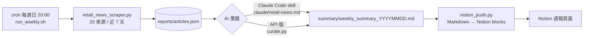

# 零售產業週報管線 Retail News Pipeline

> Weekly pipeline that scrapes 20 retail-industry news sources (TW / JP / US / KR), uses an LLM to curate the 8–12 most relevant articles for retail-industry analysis, and publishes the digest to Notion. In production since 2026-05.

每週自動從 20 個中、日、英、韓新聞來源抓零售產業新聞，再交給 AI 依設定的關注主題挑出 8–12 篇，寫成附有「延伸分析切入點」的週報，最後推送到 Notion。

**實際運作成果**：2026-05 開始每週執行，到 2026-10 已累積 **26 期**週報。每週抓 **120–200 篇**，精選 **9–13 篇**（約 7%）。

---

## 架構



| 階段 | 檔案 | 說明 |
|---|---|---|
| 擷取 | `retail_news_scraper.py` | RSS 優先、抓不到 RSS 再爬 HTML。日期格式統一轉成 UTC，只保留近 7 天的文章，並依 URL 去重。輸出 JSON、HTML，以及 NotebookLM 可匯入的純文字檔 |
| 排程 | `run_weekly.sh` | 由 cron 觸發，記錄 log，成功或失敗都發桌面通知 |
| 策展 | `claude/retail-news.md` / `curate.py` | 依優先級挑文章、寫摘要、提出可以拿數據驗證的切入點 |
| 發布 | `notion_push.py` | 自行把 Markdown 轉成 Notion block（標題、清單、粗體、連結），可推到 page 或 database |

## 新聞來源

| 地區 | 來源 |
|---|---|
| 台灣 | 數位時代、未來商務、食力、科技報橘、遠見、商周（含 YouTube）、TCFA 連鎖加盟協會 ×6 類 |
| 日本 | 食品新聞、ITmedia ビジネス、Diamond Chain Store、PR TIMES（超商新品） |
| 美國 | Retail Dive、Convenience Store News |
| 韓國 | 식품음료신문 (thinkfood) |

## 設計重點

- **人機分工**：爬蟲交給 cron 全自動跑。策展則保留一個人工觸發點（在 Claude Code 執行 `/retail-news`），讓人工看過再發布。另外提供 `curate.py` 這個 API 版，需要全自動時可以改用。
- **控制 token 用量**：策展時不把整份 JSON 丟給 LLM。先給一份「編號＋標題＋150 字摘要」的壓縮清單，挑完之後只取回入選文章的完整欄位。每週約 70KB 的原始資料，因此不會佔滿 context。
- **策展品質規則寫成規格**：「延伸分析切入點」必須寫出要用哪個數據源、比較什麼、看哪段時間，不能只寫「值得關注」；某個分類沒有夠格的文章就整節省略，不硬湊；引用標題裡的數字時要註明口徑。完整規則見 `claude/retail-news.md`。
- **單一來源失敗不影響整體**：每個來源各自 try/except，一個網站壞掉只會讓該來源變 0 篇，其餘照常產出。log 會記錄每個來源抓到的篇數，方便追查。
- **憑證與程式分離**：token 一律從 `.env` 或環境變數讀，repo 只附 `.env.example`。

## 範例輸出

- [`examples/weekly_summary_sample.md`](examples/weekly_summary_sample.md)：一期完整週報
- [`examples/articles_sample.json`](examples/articles_sample.json)：爬蟲輸出的結構（每個來源取 2 篇）

## 執行方式

```bash
python3 -m venv .venv && source .venv/bin/activate
pip install -r requirements.txt
cp .env.example .env          # 填入 NOTION_TOKEN、NOTION_PAGE_ID

python3 retail_news_scraper.py   # 1. 爬取 → reports/
# 2. 策展：在 Claude Code 執行 /retail-news（把 claude/retail-news.md 放進 .claude/commands/），
#    或用 API 版：python3 curate.py
python3 notion_push.py           # 3. 推送最新一期 summary/ 到 Notion
```

排程（每週日 20:00）：

```
0 20 * * 0 /path/to/retail-news-pipeline/run_weekly.sh
```

## 測試

```bash
pip install -r requirements-dev.txt
pytest -q
```

測試涵蓋多語系日期解析（RFC 2822、ISO、`2026年10月26日` 等寫法）、7 天時間窗過濾、欄位正規化，以及 Markdown 轉 Notion block（包含範例週報整份轉換、每段不超過 Notion 的 2000 字上限）。GitHub Actions 會在每次 push 時自動執行。
